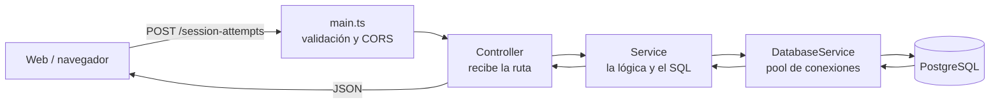
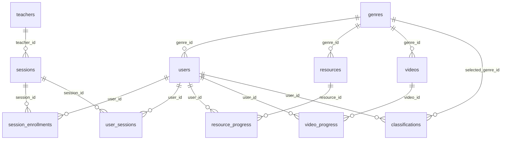
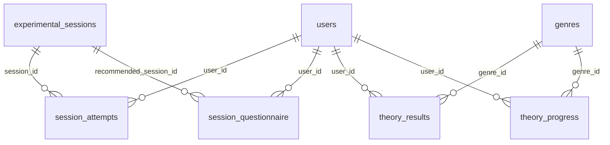

# MWT API

Back-end de la web de **Music Well Tech (MWT)**. Es una API REST hecha con **NestJS** que guarda y lee los datos en una base de datos **PostgreSQL**. Todo se arranca con **Docker**: la base de datos, la API y **pgAdmin** para ver los datos.

> Este README está pensado para quien entra por primera vez al proyecto, incluso sin experiencia previa. Si solo quieres arrancarlo, ve a [Cómo arrancarlo](#2-cómo-arrancarlo). Si quieres entender qué hace cada archivo, sigue leyendo desde la sección 5.

## Índice

1. [Qué es este proyecto](#1-qué-es-este-proyecto)
2. [Cómo arrancarlo](#2-cómo-arrancarlo)
3. [Comprobar que funciona](#3-comprobar-que-funciona)
4. [Docker en el día a día](#4-docker-en-el-día-a-día)
5. [El árbol del proyecto](#5-el-árbol-del-proyecto)
6. [Los archivos de la raíz](#6-los-archivos-de-la-raíz)
7. [`src/`: el código, módulo a módulo](#7-src-el-código-módulo-a-módulo)
8. [`db/`: la base de datos](#8-db-la-base-de-datos)
9. [Todos los endpoints](#9-todos-los-endpoints)
10. [Arrancar la API sin Docker (con npm)](#10-arrancar-la-api-sin-docker-con-npm)
11. [Cómo añadir un módulo nuevo](#11-cómo-añadir-un-módulo-nuevo)
12. [Cómo añadir o cambiar tablas](#12-cómo-añadir-o-cambiar-tablas)
13. [Reglas de código del equipo](#13-reglas-de-código-del-equipo)
14. [Seguridad](#14-seguridad)
15. [Estado actual y pendientes](#15-estado-actual-y-pendientes)
16. [Problemas frecuentes](#16-problemas-frecuentes)
17. [Glosario](#17-glosario)

---

## 1. Qué es este proyecto

Una **API** es un programa que espera peticiones ("guarda que este usuario ha terminado esta sesión", "dame el progreso de este usuario") y responde con datos. La web (el front-end hecho con Next.js, repositorio `mwt-practicas`) no habla directamente con la base de datos: le pregunta a la API, y la API es la que habla con la base de datos.

Es como un restaurante:

| En el restaurante | En nuestro proyecto |
| --- | --- |
| El cliente | La web (front-end) |
| El camarero | Esta API (NestJS) |
| La cocina y la despensa | La base de datos (PostgreSQL) |

El cliente nunca entra en la cocina. Le pide al camarero, y el camarero se encarga de todo.

### Las tres piezas, cada una en su contenedor

Con un solo comando, Docker arranca tres programas, cada uno en su propio **contenedor** (una "caja" aislada con todo lo que ese programa necesita):

| Contenedor | Qué es | Dirección en tu ordenador |
| --- | --- | --- |
| `mwt-db` | La base de datos PostgreSQL | `localhost:5433` |
| `mwt-api` | La API de NestJS | http://localhost:4000 (documentación en `/docs`) |
| `mwt-pgadmin` | pgAdmin, para ver y consultar los datos | http://localhost:5050 |

La web de Next.js usa el puerto `3000`, por eso la API está en el `4000`.

### Tecnologías

| Pieza | Qué es | Para qué la usamos |
| --- | --- | --- |
| [Docker](https://www.docker.com) | Programa que ejecuta aplicaciones en contenedores | Arrancar todo igual en cualquier ordenador, sin instalar PostgreSQL ni Node |
| [Node.js](https://nodejs.org) | Programa que ejecuta JavaScript fuera del navegador | Hace funcionar la API (va dentro del contenedor) |
| [TypeScript](https://www.typescriptlang.org) | JavaScript con tipos | Detecta errores antes de ejecutar |
| [NestJS](https://nestjs.com) | Framework para organizar una API | Estructura el código en módulos |
| [PostgreSQL](https://www.postgresql.org) | Base de datos | Guarda toda la información |
| [`pg`](https://node-postgres.com) | Librería para hablar con PostgreSQL | Enviar consultas SQL desde NestJS |
| [`class-validator`](https://github.com/typestack/class-validator) | Reglas de validación | Comprobar que los datos recibidos son correctos |
| [Swagger](https://swagger.io) | Documentación interactiva | Probar la API desde el navegador en `/docs` |
| [pgAdmin](https://www.pgadmin.org) | Interfaz gráfica de PostgreSQL | Ver las tablas y sus datos |
| [Vitest](https://vitest.dev) | Herramienta de pruebas | Tests automáticos |
| [Oxlint](https://oxc.rs) y [Prettier](https://prettier.io) | Revisor de código y formateador | Mantener el código limpio y con el mismo estilo |

### Qué pasa cuando llega una petición



1. La petición entra por `main.ts`, donde se comprueba que los datos tengan el formato correcto.
2. El **controller** mira la ruta y decide a qué función llamar. No hace nada más.
3. El **service** hace el trabajo: escribe la consulta SQL y trata los errores.
4. El **DatabaseService** envía la consulta a PostgreSQL y devuelve el resultado.
5. La respuesta vuelve por el mismo camino, en formato JSON.

---

## 2. Cómo arrancarlo

### Antes de empezar, necesitas

- [Docker Desktop](https://www.docker.com/products/docker-desktop/).
- [Git](https://git-scm.com).

No hace falta instalar Node.js ni PostgreSQL: van dentro de los contenedores.

### Paso 1. Abre Docker Desktop

Ábrelo y espera a que abajo a la izquierda ponga **Engine running**. Si ves la pantalla *Containers* con el texto "Your running containers show up here", está funcionando (vacía es normal).

> **En Windows, si la instalación falla** con "One prerequisite is not fulfilled" o Docker no arranca, abre PowerShell **como administrador**, ejecuta `wsl --install` y reinicia el ordenador.

### Paso 2. Descarga el proyecto

```bash
git clone https://github.com/MusicWellTech/mwt-api.git
cd mwt-api
```

### Paso 3. Arranca todo

Desde la carpeta del proyecto:

```bash
docker compose up -d --build
```

- `up` arranca los contenedores.
- `-d` los deja funcionando en segundo plano y te devuelve la terminal.
- `--build` construye la imagen de la API a partir del código.

La primera vez tarda unos minutos, porque descarga PostgreSQL, Node y pgAdmin y construye la API. Las siguientes veces tarda segundos.

Al arrancar por primera vez, la base de datos se crea sola: **se ejecutan los scripts de `db/` en orden** y quedan todas las tablas y las 18 sesiones experimentales cargadas.

### Paso 4. Comprueba que está en marcha

```bash
docker compose ps
```

Deben salir tres filas, las tres en estado **Up**:

```text
NAME          SERVICE   STATUS                PORTS
mwt-api       api       Up                    0.0.0.0:4000->3000/tcp
mwt-db        db        Up (healthy)          0.0.0.0:5433->5432/tcp
mwt-pgadmin   pgadmin   Up                    0.0.0.0:5050->80/tcp
```

> Si salen avisos como `The "xxxx" variable is not set`, mira [Problemas frecuentes](#16-problemas-frecuentes).

---

## 3. Comprobar que funciona

### La API: Swagger

Abre **http://localhost:4000/docs**. Es la documentación interactiva: aparecen todas las rutas y se pueden probar sin escribir código. Pulsa en una ruta, **Try it out**, rellena los datos y **Execute**.

Una prueba completa, en este orden:

1. `GET /experimental-sessions` → deben salir las 18 sesiones.
2. `POST /users` con:
   ```json
   {"cognitoId": "test-1", "name": "Prueba", "email": "prueba@test.com"}
   ```
   Apunta el `id` que devuelve (por ejemplo `1`).
3. `POST /session-attempts` con (cambia el `1` por el `id` del paso anterior):
   ```json
   {"userId": 1, "sessionId": "box-breathing"}
   ```
   Apunta el `id` del intento.
4. `PATCH /session-attempts/1` (el `id` del intento) con:
   ```json
   {"completed": true, "feelingAfter": "calm", "wouldRepeat": true}
   ```

> En los ejemplos, escribe **números reales** en `userId`. Si envías algo que no es JSON válido, la API responde `400`.

> Los números de `id` no siempre empiezan en 1. PostgreSQL no reutiliza un número aunque un intento de guardado falle. Usa siempre el `id` que te devuelve la API.

### Los datos: pgAdmin

1. Abre **http://localhost:5050**. Entra directo, sin pantalla de login. La primera vez tarda hasta un minuto en cargar.
2. A la izquierda, despliega **Servers → MWT → MWT local (Docker)**. La conexión ya está creada.
3. La primera vez te pide la contraseña de la base de datos: escribe `postgres` y marca **Save password**.
4. Despliega **Databases → mwt_dev → Schemas → public → Tables** (16 tablas).
5. Clic derecho en una tabla → **View/Edit Data → All Rows**. Para actualizar lo que ves, pulsa ▶ (*Execute*).

Tras la prueba de Swagger, en `session_attempts` verás la fila del intento con `completed = true` y la valoración.

Consultas útiles (en pgAdmin: clic derecho en `mwt_dev` → **Query Tool**):

```sql
-- Últimos intentos de sesión, con la valoración
SELECT id, user_id, session_id, completed, feeling_after, would_repeat, started_at
FROM session_attempts ORDER BY id DESC LIMIT 10;

-- Respuestas de "Te ayudamos a elegir"
SELECT * FROM session_questionnaire ORDER BY id DESC LIMIT 10;

-- Progreso y resultados de Theory Lab de un usuario
SELECT * FROM theory_progress WHERE user_id = 1;
SELECT * FROM theory_results WHERE user_id = 1 ORDER BY updated_at DESC;
```

> También puedes usar un pgAdmin instalado en tu ordenador: crea una conexión a host `localhost`, puerto `5433`, usuario `postgres`, contraseña `postgres`, base de datos `mwt_dev`.

### Desde la terminal

```bash
docker exec mwt-db psql -U postgres -d mwt_dev -c "\dt"
docker exec mwt-db psql -U postgres -d mwt_dev -c "select count(*) from experimental_sessions"
```

El primero lista las 16 tablas; el segundo debe devolver `18`.

---

## 4. Docker en el día a día

| Comando | Qué hace | Cuándo usarlo |
| --- | --- | --- |
| `docker compose up -d` | Arranca los tres contenedores | Al empezar a trabajar |
| `docker compose up -d --build` | Reconstruye la API y arranca | **Después de cambiar código de la API** o de hacer `git pull` |
| `docker compose ps` | Muestra qué está en marcha | Para comprobar |
| `docker compose stop` | Apaga sin borrar nada | Al terminar |
| `docker compose logs api` | Muestra los mensajes de la API | Si algo falla (cambia `api` por `db` o `pgadmin`) |
| `docker compose down` | Apaga y quita los contenedores; **los datos se conservan** | Para limpiar |
| `docker compose down -v` | Apaga y **borra la base de datos** y los ajustes de pgAdmin | Para empezar de cero |
| `docker compose config --services` | Lista los servicios del `docker-compose.yml` | Para comprobar que tienes la versión correcta (deben salir `db`, `api` y `pgadmin`) |

### Cosas que conviene saber

- **Los datos se guardan en un volumen** (`mwt_db_data`), una carpeta que maneja Docker. Por eso no se pierden al apagar.
- **Los scripts de `db/` solo se ejecutan la primera vez**, cuando el volumen está vacío. Si cambian los scripts (por ejemplo, tras un `git pull`), para cargarlos hay que empezar de cero: `docker compose down -v` y después `docker compose up -d --build`. **Esto borra todos los datos de prueba.**
- **Al cambiar código de la API** hay que reconstruir con `--build`. Sin él, sigue funcionando la versión anterior.
- **Dentro de Docker, los contenedores se llaman por su nombre.** La API llega a la base de datos con la dirección `db:5432`, no `localhost:5433`. `localhost:5433` es la dirección desde tu ordenador.

---

## 5. El árbol del proyecto

```text
mwt-api/
├── .dockerignore             ← lo que Docker NO copia al construir la API
├── .env.example              ← plantilla del .env (solo para arrancar sin Docker)
├── .gitattributes            ← fuerza saltos de línea iguales en todos los sistemas
├── .gitignore                ← lista de lo que Git no debe subir
├── .oxlintrc.json            ← reglas del revisor de código (lint)
├── .prettierrc               ← reglas de formato del código
├── AGENTS.md                 ← notas para asistentes de IA que trabajen en el repo
├── Dockerfile                ← receta para construir la imagen de la API
├── README.md                 ← este documento
├── docker-compose.yml        ← define los tres contenedores: db, api y pgadmin
├── nest-cli.json             ← configuración de la herramienta de línea de comandos de Nest
├── package.json              ← nombre, comandos y librerías del proyecto
├── package-lock.json         ← versiones exactas de cada librería instalada
├── tsconfig.json             ← configuración de TypeScript
├── tsconfig.build.json       ← configuración de TypeScript al compilar
├── vitest.config.ts          ← configuración de los tests unitarios
├── vitest.config.e2e.ts      ← configuración de los tests e2e
│
├── db/                       ← scripts SQL que crean las tablas (se ejecutan en orden)
│   ├── 001_genres.sql … 011_classifications.sql     ← tablas de la empresa
│   ├── 012_experimental_sessions.sql                 ← Experimental Sessions
│   ├── 013_session_attempts.sql
│   ├── 014_session_questionnaire.sql
│   ├── 015_theory_results.sql                        ← Theory Lab
│   ├── 016_theory_progress.sql
│   ├── 017_seed_experimental_sessions.sql            ← datos: las 18 sesiones
│   ├── complete/
│   │   └── mwt_schema.sql    ← todos los scripts juntos en un solo archivo
│   └── maintenance/
│       └── drop_old_experimental_tables.sql  ← borra la versión antigua de las tablas
│
├── pgadmin/
│   └── servers.json          ← conexión de pgAdmin a la base de datos, ya creada
│
├── src/                      ← EL CÓDIGO DE LA API
│   ├── main.ts               ← punto de entrada: aquí arranca todo
│   ├── app.module.ts         ← módulo raíz: lista todos los módulos de la API
│   ├── app.controller.ts     ← la ruta "/" (responde "Music Well Tech")
│   ├── app.controller.spec.ts← test de esa ruta
│   ├── app.service.ts        ← el texto que devuelve la ruta "/"
│   │
│   ├── database/             ← conexión con PostgreSQL (la usan todos los módulos)
│   │
│   ├── genres/               ← géneros musicales          (CRUD completo)
│   ├── teachers/             ← profesores                 (CRUD completo)
│   ├── users/                ← usuarios                   (CRUD completo)
│   ├── sessions/             ← sesiones en directo        (CRUD completo)
│   ├── resources/            ← recursos descargables      (CRUD + filtros)
│   ├── videos/               ← vídeos                     (CRUD + filtros)
│   ├── session-enrollments/  ← inscripciones a sesiones en directo
│   ├── user-sessions/        ← archivos que sube un usuario a una sesión
│   ├── resource-progress/    ← progreso de un usuario en los recursos
│   ├── video-progress/       ← progreso de un usuario en los vídeos
│   │
│   ├── experimental-sessions/← lista de sesiones experimentales (solo lectura)
│   ├── session-attempts/     ← cada vez que alguien hace una sesión, con su valoración
│   ├── session-questionnaire/← respuestas de "Te ayudamos a elegir"
│   ├── theory-results/       ← último resultado de cada actividad o pregunta de Theory Lab
│   ├── theory-progress/      ← hasta dónde ha avanzado cada usuario en cada género
│   │
│   └── auth/                 ← (no se usa por ahora: no está registrado en app.module.ts)
│
├── certs/
│   └── global-bundle.pem     ← (no se usa por ahora)
│
├── test/
│   └── app.e2e-spec.ts       ← test que arranca la API entera y le hace una petición
│
├── dist/                     ← (generada) código compilado; no se toca ni se sube
└── node_modules/             ← (generada) librerías descargadas; no se toca ni se sube
```

---

## 6. Los archivos de la raíz

| Archivo | Para qué sirve |
| --- | --- |
| `docker-compose.yml` | Define los tres contenedores (`db`, `api`, `pgadmin`), sus puertos, la configuración de cada uno y en qué orden arrancan: la API y pgAdmin esperan a que la base de datos esté lista. |
| `Dockerfile` | La receta de la imagen de la API, en dos etapas. La primera (`build`) instala todas las librerías y compila TypeScript. La segunda (`runtime`) solo guarda lo necesario para ejecutar: las librerías de producción y la carpeta `dist/`. Así la imagen es más pequeña. Se ejecuta con el usuario `node`, sin permisos de administrador. |
| `.dockerignore` | Lo que Docker no copia al construir: `node_modules`, `dist`, `.git`, `.env`, `db/`... |
| `pgadmin/servers.json` | Crea sola la conexión de pgAdmin a la base de datos la primera vez. |
| `package.json` | La "ficha" del proyecto: nombre, **scripts** (`npm run …`) y **dependencias**. El `"type": "module"` indica que usamos módulos modernos de JavaScript (ESM). |
| `package-lock.json` | Guarda la versión exacta de cada librería para que todo el equipo tenga lo mismo. No se edita a mano. |
| `.env.example` | Plantilla de configuración. **Solo hace falta para arrancar la API sin Docker** (sección 10). Con Docker, la configuración está en `docker-compose.yml`. |
| `.gitignore` | Dice a Git qué no subir: `node_modules`, `dist`, `.env`, logs, etc. |
| `.gitattributes` | `* text=auto eol=lf` hace que los saltos de línea sean iguales en Windows, Mac y Linux. |
| `.prettierrc` | Formato del código: comillas simples y coma final en listas. Prettier ya usa 2 espacios y punto y coma por defecto. |
| `.oxlintrc.json` | Reglas del revisor de código. Por ejemplo, avisa si dejas una promesa sin esperar (`no-floating-promises`). |
| `nest-cli.json` | Configuración de Nest. `deleteOutDir` borra `dist/` antes de compilar, y el plugin de Swagger documenta los DTO solo. |
| `tsconfig.json` / `tsconfig.build.json` | Cómo compila TypeScript el proyecto. El segundo solo mira `src/` e ignora los tests. |
| `vitest.config.ts` / `vitest.config.e2e.ts` | Dónde busca Vitest los tests (`*.spec.ts` y `*.e2e-spec.ts`). |
| `AGENTS.md` | Notas para herramientas de IA. Una persona no necesita leerlo. |

---

## 7. `src/`: el código, módulo a módulo

### La idea de NestJS en una frase

NestJS divide la API en **módulos**. Cada módulo se ocupa de un tema (géneros, usuarios, intentos de sesión…) y siempre tiene la misma forma. Si entiendes uno, entiendes todos.

### Las 5 piezas de un módulo

Tomamos como ejemplo `src/session-attempts/`:

```text
session-attempts/
├── session-attempts.module.ts        ← la "caja" que une las piezas
├── session-attempts.controller.ts    ← recibe las peticiones (rutas)
├── session-attempts.service.ts       ← hace el trabajo (lógica y SQL)
├── dto/
│   ├── create-session-attempt.dto.ts ← reglas de los datos para CREAR
│   └── update-session-attempt.dto.ts ← reglas de los datos para MODIFICAR
└── entities/
    └── session-attempt.entity.ts     ← la forma de un intento tal como lo devuelve la API
```

| Pieza | Qué hace | Analogía |
| --- | --- | --- |
| **Module** | Agrupa el controller y el service del tema. Se registra en `app.module.ts`. | La sección de un supermercado |
| **Controller** | Define las rutas (`GET`, `POST`, `PATCH`…) y llama al service. **No tiene lógica.** | El camarero que toma nota |
| **Service** | Contiene la lógica y las consultas SQL. | El cocinero |
| **DTO** (*Data Transfer Object*) | Clase con las reglas de los datos que llegan: qué campos, de qué tipo, si son obligatorios. | La hoja de pedido con casillas |
| **Entity** | Describe cómo es un registro cuando sale de la API. | La foto del plato terminado |

### Lectura guiada: un controller

```ts
// Todas las rutas de esta clase empiezan por /session-attempts
@Controller('session-attempts')
export class SessionAttemptsController {
  // Nest "inyecta" aquí el service solo: no hace falta crearlo a mano
  constructor(private readonly attemptsService: SessionAttemptsService) {}

  @Get()                       // GET /session-attempts?userId=1
  findAll(@Query('userId', new ParseIntPipe({ optional: true })) userId?: number) {
    return this.attemptsService.findAll({ userId });
  }

  @Post()                      // POST /session-attempts   (el cuerpo viaja en @Body)
  create(@Body() dto: CreateSessionAttemptDto) {
    return this.attemptsService.create(dto);
  }

  @Patch(':id')                // PATCH /session-attempts/5   (":id" es una variable)
  update(@Param('id', ParseIntPipe) id: number, @Body() dto: UpdateSessionAttemptDto) {
    return this.attemptsService.update(id, dto);
  }
}
```

Las palabras que empiezan por `@` se llaman **decoradores**: etiquetas que le dicen a Nest qué papel juega cada clase o función. `ParseIntPipe` convierte el texto `"5"` de la dirección en el número `5`.

### Lectura guiada: un service

```ts
// En la base de datos las columnas son snake_case (session_id).
// "AS" las renombra a camelCase (sessionId), que es lo que devuelve la API.
const ATTEMPT_COLUMNS = `id, user_id AS "userId", session_id AS "sessionId", ...`;

async findOne(id: number): Promise<SessionAttempt> {
  const result = await this.db.query<SessionAttempt>(
    `SELECT ${ATTEMPT_COLUMNS} FROM session_attempts WHERE id = $1`,   // $1 es un hueco para un valor
    [id],                                                              // el valor va aparte, nunca pegado al texto
  );

  if (result.rows.length === 0) {
    throw new NotFoundException(`Session attempt ${id} not found`);    // se convierte en un error 404
  }

  return result.rows[0];
}
```

Ideas importantes:

- **`$1`, `$2`…** son huecos para los valores. Los valores se pasan en una lista aparte. Así PostgreSQL nunca confunde un dato con una orden SQL. Esto protege contra la *inyección SQL*. **Regla del equipo: nunca pegar valores dentro del texto SQL.**
- **`COALESCE($2, columna)`**, en los `UPDATE`, significa "usa el valor nuevo; si no me lo han enviado, deja el que ya estaba". Por eso `PATCH` modifica solo lo que se envía.
- **Upsert** (`INSERT ... ON CONFLICT ... DO UPDATE`): "si no existe la fila, créala; si ya existe, actualízala". Lo usan `theory-results`, `theory-progress` y los progresos de recursos y vídeos. Por eso tienen una sola ruta `PUT` para crear y actualizar.

### Lectura guiada: un DTO

```ts
export class CreateSessionQuestionnaireDto {
  @IsInt()                          // debe ser un número entero
  userId: number;

  @IsString()                       // debe ser texto
  @IsNotEmpty()                     // no puede estar vacío
  goal: string;

  @IsOptional()                     // este campo se puede omitir
  @IsIn(['quick', 'short', 'long']) // solo acepta estos valores
  minutes?: string;

  @IsOptional()
  @IsArray()
  @ArrayMaxSize(3)                  // como mucho 3 palabras
  @IsString({ each: true })
  words?: string[];
}
```

Si alguien envía 4 palabras, la API responde `400` y **no llega ni a ejecutarse el service**. `main.ts` activa esta comprobación para toda la API y además rechaza los campos que no existen en el DTO.

### Arranque y configuración general

| Archivo | Qué hace |
| --- | --- |
| `main.ts` | **Punto de entrada.** Crea la aplicación, activa la validación de DTO (`whitelist` y `forbidNonWhitelisted`: rechaza campos que no existen en el DTO), activa **CORS** (permite que la web llame a la API desde otra dirección), monta Swagger en `/docs` y empieza a escuchar en `PORT`. |
| `app.module.ts` | **Módulo raíz.** Lista todos los módulos de la API. `ConfigModule.forRoot({ isGlobal: true })` lee la configuración y la deja disponible en toda la app. **Si creas un módulo nuevo, tienes que añadirlo aquí.** |
| `app.controller.ts` / `app.service.ts` | La ruta `GET /`, que devuelve `Music Well Tech`. |

### `database/`: la conexión con PostgreSQL

| Archivo | Qué hace |
| --- | --- |
| `database.service.ts` | Crea un **pool de conexiones**: un grupo de conexiones abiertas que se reutilizan, mucho más rápido que abrir una por petición. Lee `DATABASE_URL` (con `getOrThrow`, que para la app al arrancar si falta). Ofrece un único método, `query(sql, params)`, que usan todos los services. |
| `database.module.ts` | Es `@Global()`: cualquier módulo puede usar `DatabaseService` sin importarlo otra vez. |
| `pg-errors.ts` | Reconoce códigos de error de PostgreSQL: `23505` (valor duplicado), `23503` (referencia a algo que no existe) y `23514` (un dato incumple una regla `CHECK`). Los services los usan para devolver errores claros (`409`, `400`) en vez de un error genérico `500`. |

### Los módulos

Todos siguen la estructura de las 5 piezas.

**Tablas de la empresa**

| Módulo | Tabla(s) | Qué hace | Particularidades |
| --- | --- | --- | --- |
| `genres` | `genres` | Géneros musicales con color e icono. | El nombre es único: si ya existe, responde `409`. |
| `teachers` | `teachers` | Profesores. | El email es único. |
| `users` | `users` | Usuarios de la web. | El email y `cognitoId` son únicos. |
| `sessions` | `sessions` | Sesiones en directo que da un profesor. | Comprueba que el profesor exista y que `minStudents` no supere `maxStudents`. |
| `resources` | `resources` | Documentos y partituras. | Filtros: `?genreId=1&instrument=guitar&difficultyLevel=beginner`. |
| `videos` | `videos` | Vídeos de aprendizaje. | Mismos filtros que `resources`. |
| `session-enrollments` | `session_enrollments`, `sessions` | Un usuario se apunta a una sesión en directo. | Apuntarse y cancelar son **operaciones atómicas**: o se hace todo o nada. Al cancelar, la fila pasa a `cancelled`. |
| `user-sessions` | `user_sessions` | Archivos que un usuario sube en una sesión. | Filtros: `?userId=` y `?sessionId=`. |
| `resource-progress` | `resource_progress` | Cuánto ha visto un usuario de cada recurso. | Un único `PUT` crea o actualiza. `/summary` da el porcentaje total. |
| `video-progress` | `video_progress` | Qué vídeos ha visto un usuario. | Igual que el anterior. |

**Experimental Sessions**

| Módulo | Tabla | Qué hace | Particularidades |
| --- | --- | --- | --- |
| `experimental-sessions` | `experimental_sessions` | Lista de las sesiones que existen. | **Solo lectura**: los datos vienen del script `017`. El `id` es un texto (`box-breathing`). Filtros: `?branch=health&active=true`. |
| `session-attempts` | `session_attempts` | Una fila cada vez que alguien hace una sesión, con su valoración final. | `POST` al empezar (o al final, con todo). `PATCH` para terminar y añadir la valoración. El `PATCH` no deja cambiar el usuario ni la sesión. `details` guarda lo propio de cada sesión (bloques de Pomodoro, variante de ritmo…). |
| `session-questionnaire` | `session_questionnaire` | Respuestas de "Te ayudamos a elegir". | Como mucho 3 palabras. `minutes` solo acepta `quick`, `short` o `long`. |

**Theory Lab**

| Módulo | Tabla | Qué hace | Particularidades |
| --- | --- | --- | --- |
| `theory-results` | `theory_results` | El **último** resultado de cada usuario en cada actividad o pregunta. | `PUT` crea o actualiza (upsert). Una actividad marcada como completada no vuelve a "no completada". `answer` guarda cualquier respuesta en JSON. |
| `theory-progress` | `theory_progress` | Hasta dónde ha avanzado cada usuario en cada género (por ejemplo `1.1.1`). | `PUT` crea o actualiza. **Solo avanza**: si llega un paso anterior, se mantiene el guardado. Compara como números: `1.1.10` va después de `1.1.9`. |

> **De momento, el usuario viaja en la petición** (`userId`). Todavía no hay inicio de sesión, así que la API no sabe por sí sola quién hace cada petición.

### Los tests

| Archivo | Qué prueba |
| --- | --- |
| `src/app.controller.spec.ts` | Test unitario (`npm run test`): llama al controller de `/` directamente. |
| `test/app.e2e-spec.ts` | Test e2e (`npm run test:e2e`): arranca la API entera y hace una petición real a `/`. |

---

## 8. `db/`: la base de datos

Cada archivo `.sql` es un **script** que crea una o varias tablas. Están numerados porque **unas tablas dependen de otras**: no puedes crear `users` antes que `genres` porque `users` apunta a `genres`.

Los scripts usan `CREATE TABLE IF NOT EXISTS`, así que ejecutarlos dos veces no rompe nada. El `017` usa `ON CONFLICT DO NOTHING` por lo mismo.

### Qué contiene cada script

**Tablas de la empresa (no se cambian)**

| Script | Tablas | Para qué |
| --- | --- | --- |
| `001_genres.sql` | `genres` | Géneros musicales. Otras tablas apuntan a ella. |
| `002_teachers.sql` | `teachers` | Profesores. |
| `003_users.sql` | `users` | Usuarios. |
| `004_sessions.sql` | `sessions` | Sesiones en directo de un profesor, con plazas mínimas, máximas y ocupadas. |
| `005_resources.sql` | `resources` | Recursos descargables. `attachments` es un JSON con archivos adjuntos. |
| `006_videos.sql` | `videos` | Vídeos. |
| `007_session_enrollments.sql` | `session_enrollments` | Un usuario apuntado a una sesión. |
| `008_user_sessions.sql` | `user_sessions` | Archivos subidos por un usuario en una sesión. |
| `009_resource_progress.sql` | `resource_progress` | Progreso por usuario y recurso. |
| `010_video_progress.sql` | `video_progress` | Progreso por usuario y vídeo. |
| `011_classifications.sql` | `classifications` | Resultado del cuestionario de nivel de cada usuario. |

**Experimental Sessions y Theory Lab (nuestras)**

| Script | Tabla | Columnas principales |
| --- | --- | --- |
| `012_experimental_sessions.sql` | `experimental_sessions` | `id` (texto), `branches` (lista de ramas), `category`, `active` |
| `013_session_attempts.sql` | `session_attempts` | `user_id`, `session_id`, `started_at`, `finished_at`, `completed`, `score`, `details` (JSON), `feeling_after`, `would_repeat` |
| `014_session_questionnaire.sql` | `session_questionnaire` | `user_id`, `goal`, `minutes`, `words` (lista, máx. 3), `recommended_session_id`, `created_at` |
| `015_theory_results.sql` | `theory_results` | Clave: `user_id` + `genre_id` + `item_id`. `kind` (`activity` o `question`), `completed`, `correct`, `answer` (JSON), `score`, `updated_at` |
| `016_theory_progress.sql` | `theory_progress` | Clave: `user_id` + `genre_id`. `progress` (por ejemplo `1.1.1`), `updated_at` |
| `017_seed_experimental_sessions.sql` | (solo datos) | Las 18 sesiones del front (`src/data/experimental-sessions/sessions.ts` de `mwt-practicas`). `category` es la carpeta de su ruta (`health`, `corporate`, `focus-mode`, `gaming`, `cultural`); vacía si la sesión aún no tiene página. |

### Por qué hay tan pocas tablas

Solo se guarda en la base de datos lo que **genera el usuario**: intentos, valoraciones, respuestas, resultados y progreso. Los títulos, textos, preguntas, emociones, configuración de las respiraciones, etc. **viven en el front** (en `mwt-practicas`, con sus traducciones). Lo que se puede calcular (porcentajes, récords, minutos totales…) tampoco se guarda: se calcula a partir de estas tablas.

### Cómo se relacionan las tablas

Tablas de la empresa:



Experimental Sessions y Theory Lab:



> **No confundir dos tablas parecidas.** `sessions` (con `id` numérico) son las **sesiones en directo** con un profesor. `experimental_sessions` (con `id` de texto, como `box-breathing`) son las **sesiones experimentales** de la web, que cada persona hace a su ritmo.

### Conceptos de SQL que aparecen en los scripts

| Lo que verás | Qué significa |
| --- | --- |
| `PRIMARY KEY` | El identificador único de cada fila. Puede ser de varias columnas (`PRIMARY KEY (user_id, genre_id)`). |
| `GENERATED ALWAYS AS IDENTITY` | El número se genera solo y va subiendo (1, 2, 3…). |
| `REFERENCES genres (id)` | **Clave foránea**: este valor debe existir en la otra tabla. |
| `ON DELETE CASCADE` | Si se borra la fila "padre", se borran también sus filas dependientes. |
| `ON DELETE SET NULL` | Si se borra la fila "padre", este campo queda vacío en vez de borrar la fila. |
| `NOT NULL` / `DEFAULT` | Obligatorio / valor por defecto si no se indica. |
| `UNIQUE` | No puede repetirse. |
| `CHECK (...)` | Regla que el dato debe cumplir (por ejemplo, `cardinality(words) <= 3`). |
| `TEXT[]` | Una lista de textos dentro de una sola columna. |
| `JSONB` | Columna que guarda un objeto JSON. |
| `TIMESTAMPTZ` | Fecha y hora con zona horaria. |
| `CREATE INDEX` | Acelera las búsquedas por esa columna. |

### Las subcarpetas de `db/`

Docker **ignora las subcarpetas** al crear la base de datos: solo ejecuta los archivos sueltos de `db/`.

- **`complete/mwt_schema.sql`**: todos los scripts (`001` a `017`) unidos en un archivo. Sirve para crear la base de datos **sin Docker**, en una base de datos vacía: se abre en pgAdmin (*Query Tool*) y se ejecuta una vez. No se ejecuta junto con los scripts numerados.
- **`maintenance/drop_old_experimental_tables.sql`**: **borra** las tablas de la primera versión de Experimental Sessions y **todos sus datos**. Solo hace falta en una base de datos que todavía las tenga, y antes del script `012`. Una base de datos nueva de Docker no lo necesita.

---

## 9. Todos los endpoints

Esta tabla resume las rutas. La versión interactiva, con los campos de cada una, está en http://localhost:4000/docs.

### Rutas de CRUD completo

Aplican a `genres`, `teachers`, `users`, `sessions`, `resources`, `videos` y `user-sessions`:

| Método | Ruta | Qué hace | Respuesta |
| --- | --- | --- | --- |
| `GET` | `/<módulo>` | Lista todo | `200` |
| `GET` | `/<módulo>/:id` | Un elemento | `200` o `404` |
| `POST` | `/<módulo>` | Crea uno | `201` |
| `PATCH` | `/<módulo>/:id` | Modifica solo los campos enviados | `200` o `404` |
| `DELETE` | `/<módulo>/:id` | Lo borra | `204` o `404` |

Filtros opcionales en el `GET` de la lista:

| Módulo | Filtros |
| --- | --- |
| `resources`, `videos` | `?genreId=`, `?instrument=`, `?difficultyLevel=` |
| `user-sessions` | `?userId=`, `?sessionId=` |

### Rutas de la empresa con comportamiento propio

| Método | Ruta | Qué hace |
| --- | --- | --- |
| `GET` | `/` | Devuelve el texto `Music Well Tech` |
| `GET` | `/session-enrollments` | Lista inscripciones. Filtros: `?userId=`, `?sessionId=`, `?status=` |
| `GET` | `/session-enrollments/:id` | Una inscripción |
| `POST` | `/session-enrollments` | Apunta a un usuario (`userId`, `sessionId`). `409` si está llena o ya inscrito |
| `POST` | `/session-enrollments/:id/cancel` | Cancela la inscripción y libera la plaza |
| `PATCH` | `/session-enrollments/:id` | Cambia asistencia y valoración (1 a 5) |
| `GET` | `/resource-progress` | Lista progresos. Filtros: `?userId=`, `?resourceId=` |
| `GET` | `/resource-progress/summary` | Porcentaje de recursos vistos. Necesita `?userId=`; opcional `?genreId=` |
| `PUT` | `/resource-progress` | Crea o actualiza el progreso de un usuario en un recurso |
| `GET` | `/video-progress` | Lista progresos. Filtros: `?userId=`, `?videoId=` |
| `GET` | `/video-progress/summary` | Porcentaje de vídeos vistos. Necesita `?userId=`; opcional `?genreId=` |
| `PUT` | `/video-progress` | Crea o actualiza el progreso de un usuario en un vídeo |
| `GET` | `/docs` | Documentación interactiva (Swagger) |

### Experimental Sessions

| Método | Ruta | Qué hace |
| --- | --- | --- |
| `GET` | `/experimental-sessions` | Lista las sesiones. Filtros: `?branch=health`, `?active=true` |
| `GET` | `/experimental-sessions/:id` | Una sesión, por su id de texto (`/experimental-sessions/box-breathing`) |
| `GET` | `/session-attempts` | Lista intentos, del más nuevo al más antiguo. Filtros: `?userId=`, `?sessionId=` |
| `GET` | `/session-attempts/:id` | Un intento |
| `POST` | `/session-attempts` | Crea un intento. Obligatorios: `userId`, `sessionId` |
| `PATCH` | `/session-attempts/:id` | Termina el intento o añade la valoración (`finishedAt`, `completed`, `score`, `details`, `feelingAfter`, `wouldRepeat`) |
| `GET` | `/session-questionnaire` | Lista respuestas, de la más nueva a la más antigua. Filtro: `?userId=` |
| `GET` | `/session-questionnaire/:id` | Una respuesta |
| `POST` | `/session-questionnaire` | Guarda las respuestas. Obligatorios: `userId`, `goal` |

Ejemplo de `POST /session-attempts` con todo a la vez:

```json
{
  "userId": 1,
  "sessionId": "study-pomodoro",
  "startedAt": "2026-11-24T18:00:00Z",
  "finishedAt": "2026-11-24T19:55:00Z",
  "completed": true,
  "details": { "blocks": 4 },
  "feelingAfter": "calm",
  "wouldRepeat": true
}
```

### Theory Lab

| Método | Ruta | Qué hace |
| --- | --- | --- |
| `GET` | `/theory-results` | Lista resultados. Filtros: `?userId=`, `?genreId=` |
| `PUT` | `/theory-results` | Crea o actualiza el resultado de un usuario en una actividad o pregunta |
| `GET` | `/theory-progress` | Lista progresos. Filtros: `?userId=`, `?genreId=` |
| `PUT` | `/theory-progress` | Guarda el paso alcanzado (nunca retrocede) |

Ejemplos:

```json
// PUT /theory-results
{ "userId": 1, "genreId": 1, "itemId": "1.1.quiz-1", "kind": "question", "completed": true, "correct": false, "answer": ["a", "c"] }

// PUT /theory-progress
{ "userId": 1, "genreId": 1, "progress": "1.1.2" }
```

### Códigos de respuesta que verás

| Código | Significa |
| --- | --- |
| `200` | Todo bien |
| `201` | Creado |
| `204` | Hecho, sin contenido que devolver (borrados) |
| `400` | Los datos enviados no son válidos o hacen referencia a algo que no existe (un `userId` o `sessionId` inexistente) |
| `404` | No existe lo que pides |
| `409` | Conflicto: duplicado, sesión llena, ya cancelada… |
| `500` | Error inesperado del servidor |

---

## 10. Arrancar la API sin Docker (con npm)

Es la forma de trabajar si vas a **programar la API** y quieres que se reinicie sola cada vez que guardas un archivo. La base de datos y pgAdmin siguen en Docker.

Necesitas [Node.js](https://nodejs.org) 22 o superior.

1. Instala las librerías:
   ```bash
   npm install
   ```
2. Arranca solo la base de datos y pgAdmin:
   ```bash
   docker compose up -d db pgadmin
   ```
   Si el contenedor `mwt-api` está en marcha, páralo con `docker compose stop api`, porque usa el mismo puerto `4000`.
3. Crea tu archivo `.env` a partir del ejemplo:
   ```bash
   # Windows (PowerShell)
   Copy-Item .env.example .env

   # Mac o Linux
   cp .env.example .env
   ```
   Los valores del ejemplo ya sirven para la base de datos de Docker (`localhost:5433`) y el puerto `4000`.
4. Arranca la API:
   ```bash
   npm run start:dev
   ```
   Verás `Nest application successfully started`. Para pararla, `Ctrl + C`.

### Todos los comandos de npm

| Comando | Qué hace |
| --- | --- |
| `npm run start:dev` | Arranca la API y la reinicia al guardar cambios. |
| `npm run start` | Arranca la API una vez, sin reinicio automático. |
| `npm run start:debug` | Como `start:dev`, pero permite depurar paso a paso. |
| `npm run build` | Compila TypeScript a JavaScript en la carpeta `dist/`. |
| `npm run start:prod` | Ejecuta lo ya compilado en `dist/` (es lo que hace el contenedor). |
| `npm run lint` | Revisa el código con Oxlint y avisa de problemas. |
| `npm run format` | Da formato al código con Prettier. |
| `npm run test` | Ejecuta los tests unitarios. |
| `npm run test:e2e` | Ejecuta los tests de extremo a extremo. |
| `npm run test:cov` | Ejecuta los tests y muestra cuánto código cubren. |

### Variables del `.env`

| Variable | Obligatoria | Para qué sirve |
| --- | --- | --- |
| `DATABASE_URL` | Sí | Dirección de la base de datos. Si falta, la API no arranca. |
| `PORT` | No | Puerto en el que escucha la API. Por defecto `3000`; usamos `4000`. |
| `CORS_ORIGINS` | No | Direcciones del front-end que pueden llamar a la API, separadas por comas. |

---

## 11. Cómo añadir un módulo nuevo

Ejemplo: un módulo `instruments`.

1. **Crea la carpeta con la misma estructura** que `session-attempts/`:

   ```text
   src/instruments/
   ├── dto/create-instrument.dto.ts
   ├── dto/update-instrument.dto.ts
   ├── entities/instrument.entity.ts
   ├── instruments.controller.ts
   ├── instruments.module.ts
   └── instruments.service.ts
   ```

   Copiar y adaptar un módulo parecido es la forma más rápida de empezar.

2. **Escribe cada pieza**, en este orden:
   1. La **entity**: los campos tal como los devuelve la API.
   2. Los **DTO**: los campos que se envían y sus reglas de validación.
   3. El **service**: las consultas SQL con `$1, $2…`, renombrando columnas con `AS`.
   4. El **controller**: solo rutas, **sin lógica**, que llaman al service.
   5. El **module**: lista el controller y el service.

3. **Registra el módulo** en `src/app.module.ts`, añadiéndolo al array `imports`.

4. **Importante en ESM:** los imports relativos terminan en `.js`, aunque el archivo sea `.ts`. Por ejemplo `import { X } from './x.js'`.

5. Comprueba con `npm run build` y `npm run lint`, y prueba la ruta nueva en `/docs` (con `npm run start:dev`, o reconstruyendo con `docker compose up -d --build`).

Si el módulo necesita una tabla nueva, antes sigue la sección siguiente.

---

## 12. Cómo añadir o cambiar tablas

No usamos una herramienta de migraciones. Las tablas se definen con los scripts de `db/`:

1. Crea un archivo nuevo con el **siguiente número**: `018_nombre.sql`.
2. Si es una tabla nueva, usa `CREATE TABLE IF NOT EXISTS`.
3. Si es un cambio en una tabla existente, usa `ALTER TABLE` en un archivo nuevo, para no tocar los anteriores.
4. Indica en un comentario al principio del archivo de qué otros scripts depende.
5. Pruébalo en tu base de datos local: `docker compose down -v` y `docker compose up -d --build` ejecutan todos los scripts desde cero (esto borra tus datos de prueba).
6. Actualiza `db/complete/mwt_schema.sql` para que siga teniendo todos los scripts.
7. Avisa al equipo: cada persona tendrá que hacer `docker compose down -v` para recibir el cambio.

---

## 13. Reglas de código del equipo

- **Formato:** 2 espacios, comillas simples y punto y coma. `npm run format` lo arregla solo.
- **Sin `console.log`**, sin `any` y sin código comentado.
- **Commits pequeños y descriptivos** con prefijo: `feat:` (algo nuevo), `fix:` (arreglo), `docs:`, `refactor:`, `test:`.
- **Controller sin lógica.** La lógica va en el service.
- **DTO de clase con validación** (`class-validator`) para todo lo que llega.
- **SQL siempre con parámetros** (`$1`, `$2`…). Nunca pegar valores en el texto SQL.
- **Imports con `.js`** al final (el proyecto es ESM).
- Los comentarios del código se escriben en inglés y explican el **porqué**, no repiten lo que ya dice el código.
- Trabaja en tu propia rama y no subas directamente a `main`.

---

## 14. Seguridad

- **Las contraseñas de `docker-compose.yml`** (`postgres` / `postgres` y la de pgAdmin) son de ejemplo y **solo sirven para tu ordenador**. Nunca se usan en un servidor real.
- **El `.env` nunca se sube.** Está en `.gitignore`. Si sospechas que una contraseña se ha subido por error, avisa y cámbiala de inmediato.
- **No compartas contraseñas por chat ni por el repositorio.**
- **No ejecutes `npm audit fix --force`**: puede actualizar librerías a versiones que rompan el proyecto.
- **La API no tiene inicio de sesión todavía.** Cualquiera que llegue a ella puede leer y modificar datos. Está pensada **solo para trabajar en local**: no hay que exponerla a internet.

---

## 15. Estado actual y pendientes

**Hecho**

- Base de datos con las tablas de la empresa y las 5 tablas de Experimental Sessions y Theory Lab, más las 18 sesiones cargadas.
- API con módulos para todas las tablas y documentación en `/docs`.
- Docker: base de datos, API y pgAdmin con un solo comando.
- Probado de punta a punta: lo que se envía a la API se guarda y se ve en pgAdmin.

**Pendiente**

- Conectar la web (`mwt-practicas`) con esta API, para que guarde los intentos, las respuestas y el progreso.
- Inicio de sesión: mientras no exista, el usuario viaja en la petición (`userId`).
- Pocos tests: solo existen los de la ruta `/`.

---

## 16. Problemas frecuentes

| Problema | Causa | Solución |
| --- | --- | --- |
| Docker Desktop no instala o no arranca en Windows ("One prerequisite is not fulfilled") | Falta la plataforma de máquinas virtuales de Windows | PowerShell como administrador: `wsl --install` y reiniciar |
| Avisos `The "xxxx" variable is not set. Defaulting to a blank string` | Docker Compose lee solo el `.env` de la carpeta, y algún valor suyo lleva el carácter `$`, que interpreta como variable | No rompe nada. Para quitarlos: `docker compose --env-file .env.example up -d`, o pon ese valor del `.env` entre comillas simples |
| `docker compose ps` no muestra los tres contenedores | El `docker-compose.yml` no es la última versión, o falta hacer `up` | `docker compose config --services` debe listar `db`, `api` y `pgadmin`. Si no, actualiza el archivo (`git pull`) |
| http://localhost:5050 no carga | pgAdmin tarda hasta un minuto en prepararse la primera vez | Espera y recarga. Comprueba con `docker compose logs pgadmin` que sale `Listening at`. Escribe `http://`, no `https://` |
| Tras un `git pull` no aparecen tablas nuevas | Los scripts de `db/` solo se ejecutan con la base de datos vacía | `docker compose down -v` y `docker compose up -d --build` (borra los datos de prueba) |
| Cambié código de la API y no se nota | El contenedor sigue con la imagen anterior | `docker compose up -d --build` |
| La API responde `400` "is not valid JSON" | El cuerpo de la petición no es JSON válido (por ejemplo, se dejó un hueco como `<id>`) | Escribe valores reales: `{"userId": 1, "sessionId": "box-breathing"}` |
| La API responde `400` "userId or sessionId does not exist" | El usuario o la sesión no existen en la base de datos | Comprueba los ids con `GET /users` y `GET /experimental-sessions` |
| `npm run start:dev` dice que el puerto `4000` está ocupado | El contenedor `mwt-api` ya usa ese puerto | `docker compose stop api` |

---

## 17. Glosario

| Palabra | Qué significa |
| --- | --- |
| **API** | Programa que recibe peticiones y devuelve datos. |
| **REST** | Estilo de API donde cada dirección (`/genres`) representa un tipo de dato, y el método (`GET`, `POST`…) la acción. |
| **Endpoint** | Una ruta concreta de la API, como `GET /genres`. |
| **CRUD** | *Create, Read, Update, Delete*: crear, leer, modificar y borrar. |
| **JSON** | Formato de texto para intercambiar datos: `{ "name": "Funk" }`. |
| **DTO** | Clase que describe y valida los datos que llegan a la API. |
| **Entity** | Descripción de cómo es un registro al salir de la API. |
| **Módulo, controller, service** | Las tres piezas principales de NestJS (ver sección 7). |
| **Inyección de dependencias** | Nest crea y entrega solo las piezas que una clase necesita (por eso el `constructor` recibe el service sin que lo creemos). |
| **ORM** | Herramienta que esconde el SQL. **Aquí no usamos ninguno**: escribimos SQL a mano con `pg`. |
| **Pool de conexiones** | Grupo de conexiones a la base de datos que se reutilizan. |
| **Upsert** | "Crea si no existe, actualiza si ya existe". |
| **CORS** | Permiso para que una web en una dirección llame a una API en otra. |
| **ESM** | Sistema moderno de módulos de JavaScript (`import … from`). |
| **Docker** | Programa que ejecuta aplicaciones dentro de contenedores. |
| **Imagen** | La "plantilla" de un contenedor: el programa con todo lo que necesita. Se construye con el `Dockerfile`. |
| **Contenedor** | Una imagen en marcha. Aquí hay tres: `mwt-db`, `mwt-api` y `mwt-pgadmin`. |
| **Volumen** | Carpeta que maneja Docker para que los datos no se pierdan al apagar los contenedores. |
| **Docker Compose** | Herramienta que arranca varios contenedores a la vez a partir de `docker-compose.yml`. |
| **Seed** | Datos iniciales que se cargan en una tabla (`017_seed_experimental_sessions.sql`). |
| **Migración** | Script que cambia la estructura de la base de datos de forma ordenada. |
